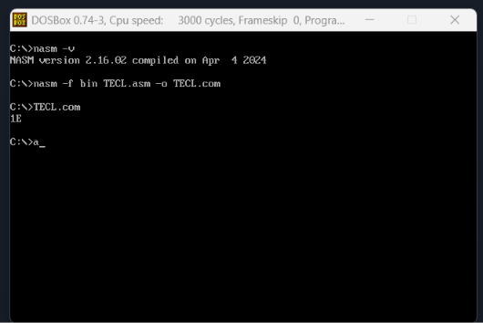
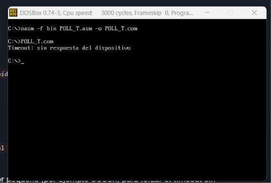
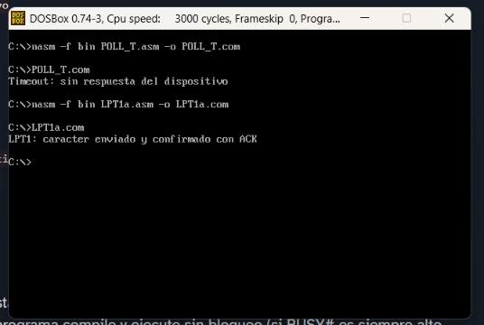
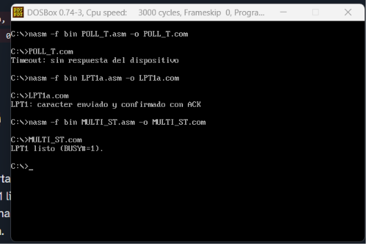

# Post-contenido Unidad 9: Entrada y Salida Avanzados (Puertos, Polling e Interrupciones)

**Asignatura:** Arquitectura de Computadores
**Plataforma:** NASM 2.x sobre DOSBox 0.74

## Estructura del repositorio

```
apellido-post1-u9/
├── README.md
├── parte1/
│   ├── TECL.ASM / TECL.COM
│   ├── POLL_T.ASM / POLL_T.COM
│   ├── LPT1.ASM / LPT1.COM
│   ├── MULTI_ST.ASM / MULTI_ST.COM
└── parte2/
│   ├── ISR_KB.ASM / ISR_KB.COM
│   ├── MASK_KB.ASM / MASK_KB.COM
│   ├──ISR_CHAIN.ASM / ISR_CHAIN.COM
│   ├── ISR_TIME.ASM / ISR_TIME.COM
└── capturas/
```

## Capturas de pantalla

Todas están en la carpeta `capturas/` y se organizan según el programa `.asm` ejecutado.

### Parte 1

#### `parte1/TECL.asm` — P1-C1



#### `parte1/POLL_T.asm` — P1-C2



#### `parte1/LPT1a.asm` — P1-C3



#### `parte1/MULTI_ST.asm` — P1-C4



# Parte 1: Acceso directo a puertos de E/S

### LPT1.ASM: escritura al puerto paralelo (Checkpoint 3)

Espera BUSY# = 1 en 0x379 (bit 7), coloca el carácter `A` (41h) en 0x378 y genera el pulso de STROBE sobre el bit 0 de 0x37A, con un retardo corto entre la activación y la desactivación.

```
nasm -f bin LPT1a.ASM -o LPT1a.COM
LPT1a
```

**Comportamiento observado en DOSBox:** al ejecutar LPT1.COM el programa terminó sin bloquearse y mostró “LPT1: caracter enviado y confirmado con ACK”. DOSBox no tiene impresora física conectada, pero el puerto emulado devuelve en 0379h BUSY#=1 y ACK#=0 de forma inmediata. Por eso .wait_ready salió en la primera iteración y .wait_ack detectó el ACK sin espera.

## Decisión técnica 1: ¿Polling sin límite o polling con timeout configurable?

El bucle sin límite de `TECL.ASM` es aceptable únicamente cuando el dispositivo está garantizado a responder. En este laboratorio ocurre en un programa de demostración donde el propio estudiante presiona la tecla: el programa espera exactamente el evento que él mismo provocará. En cambio, el timeout de `POLL_T.ASM` es indispensable cuando el programa no puede asumir que el dispositivo responderá (un periférico desconectado, defectuoso o apagado), porque un bucle sin límite dejaría el sistema bloqueado para siempre sin ninguna forma de recuperación ni de informar el error.

El timeout tiene un costo: si `MAX_RETRY` se reduce demasiado (por ejemplo a `5h` en lugar de `0FFFFh`), el programa puede declarar un falso timeout con un dispositivo lento pero funcional, que habría respondido un poco después de que el contador se agotara. El valor debe elegirse con margen suficiente para el dispositivo más lento esperado.

Además, el contador de `POLL_T.ASM` mide iteraciones del bucle, no tiempo real. Cuántas iteraciones caben en un segundo depende de la velocidad de la CPU o del emulador (los ciclos de DOSBox son configurables), por lo que el mismo valor produce esperas distintas en máquinas distintas. Es una medida de tiempo indirecta. El contador de ticks del sistema en `0040h:006Ch`, usado en la Parte 2, lo incrementa el timer (IRQ0) a ~18.2 Hz y mide tiempo real sin importar qué tan rápido se ejecute el bucle que lo consulta.

## Decisión técnica 2: ¿Combinar banderas de dos puertos con OR o verificarlas por separado?

El OR de `MULTI_ST.ASM` permite esperar el primero de dos eventos con un solo bucle, pero tiene una debilidad en DOSBox: como no hay impresora física, LPT1 reporta su bit de listo en 1 de forma permanente. Por eso `.poll` se detiene en la primera iteración sin importar el estado del teclado, y el programa nunca espera realmente al segundo dispositivo. La consecuencia práctica es que la espera combinada pierde su utilidad: se comporta como si solo existiera LPT1. Un dispositivo permanentemente listo anula la combinación.

Después de salir del bucle es necesario examinar BL y BH por separado porque el OR descarta la información de cuál bandera causó la salida: un resultado distinto de cero solo indica que "alguno" está listo, no cuál, ni si son ambos. Sin esa verificación posterior, el programa no sabría a qué dispositivo atender, o atendería a uno que no está listo.

Si en lugar de OR se usara AND, el programa esperaría que ambas condiciones se cumplan simultáneamente. Esto sería apropiado para una sincronización tipo rendezvous: por ejemplo, no enviar un dato a la impresora hasta que el usuario haya presionado una tecla Y la impresora esté lista. El OR, en cambio, solo necesita que ocurra el primero de los dos eventos.
